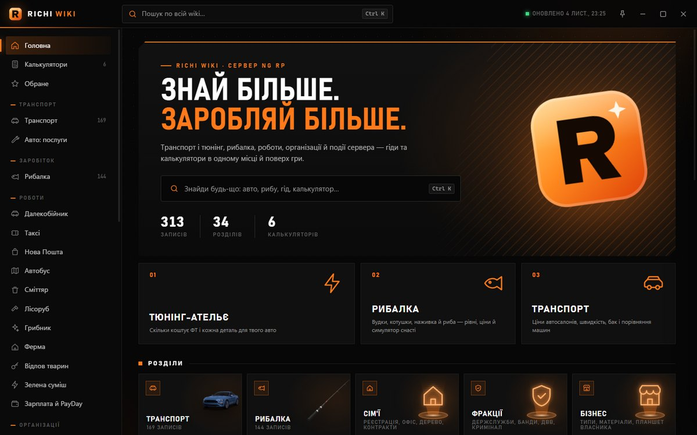
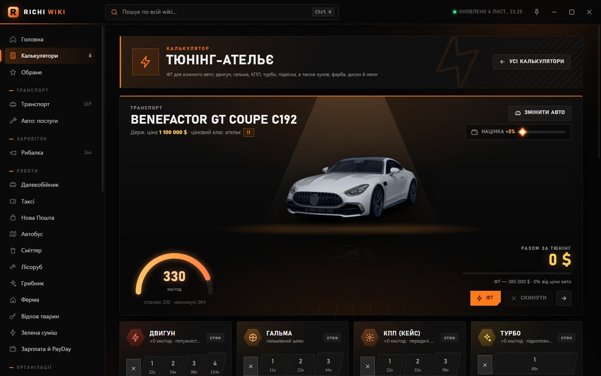
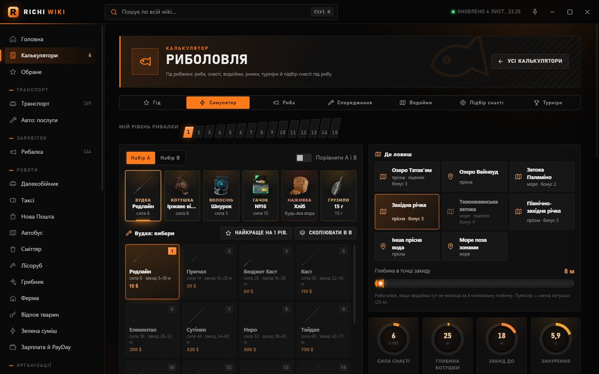
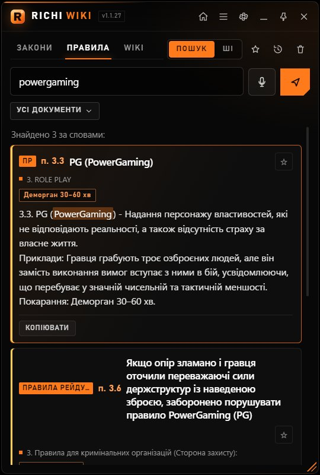
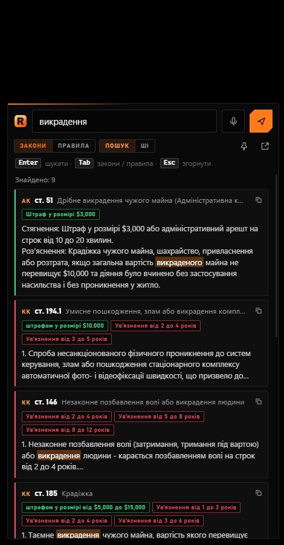

# Richi Wiki

**Помічник для гравців NG RP (GTA 5): закони, правила, ШІ-юрист і wiki сервера поверх гри**

Знайди статтю за секунду, спитай ШІ своїми словами, порахуй тюнінг чи підбери снасть, і все це не виходячи з гри.

**[🌐 Сайт проєкту](https://xomyakdru.github.io/ng-helper/)** · **[📦 Усі версії](https://github.com/XomyakDru/NG-helper/releases)**

> [!NOTE]
> **Неофіційний фанатський проєкт.** Richi Wiki (раніше NG Helper) зроблена гравцем для гравців і не має жодного стосунку до адміністрації, розробників чи команди NG RP (ng-gta5.com). Це не офіційний продукт NG, і сервер за неї не відповідає.

---

## ✨ Що вміє

| | |
|---|---|
| ⚖️ **Уся законодавча база** | Конституція, кодекси й закони штату NG. Програма сама підтягує їх із сайту, входити в акаунт не треба |
| 📜 **Правила сервера** | Загальні правила, правила держорганізацій, крайму, лідерів і допитів з покараннями |
| ⚡ **Миттєвий пошук** | За номером (`1.5 ТК`) або словами. Без ШІ, без ліміту, зі штрафом і терміном одразу в картці |
| 🤖 **ШІ-юрист** | Питаєш своїми словами й отримуєш **вердикт, аналіз, статті, правила й що робити**. **50 запитів на день** безкоштовно |
| 🧲 **Помічник збоку екрана** | Язичок біля краю: навів, написав, побачив статтю. Прибрав мишку, і він згорнувся, а гра знову у фокусі |
| 🎙 **Голосом** | Затиснув мікрофон, сказав, відпустив, і запит уже пішов |
| 📚 **Richi Wiki** | 169 машин з цінами автосалонів, рибалка, роботи, сім'ї, фракції, бізнес, події, понад 30 гідів |
| 🧮 **Калькулятори** | Тюнінг-ательє (ФТ і кожна деталь), контейнери порту, підбір авто, симулятор снасті, журнал угод, таймери |
| 🎮 **Поверх гри** | Вікно закріплюється поверх GTA, а кліки проходять крізь нього, тож гра не втрачає фокус |
| 🔔 **Зміни в законах** | Показує «було → стало» й надсилає сповіщення Windows |
| ⌨️ **Гарячі клавіші** | Усе керування з клавіатури, і кожну клавішу можна змінити |
| 🔄 **Автооновлення** | Нові версії приходять самі |

&nbsp;

## 🚀 Встановлення

1. **[Завантаж NG-Helper-Setup.exe](https://github.com/XomyakDru/NG-helper/releases/latest/download/NG-Helper-Setup.exe)** і запусти. Це інсталятор Richi Wiki.
2. Готово: закони й правила завантажаться самі, **входити в акаунт не потрібно**.

> **GTA має працювати в режимі «У вікні без рамки» (Borderless)**, інакше вікно не буде видно поверх гри.
>
> Windows може показати «Невідомий видавець»: натисни **Детальніше → Виконати все одно**. Так буває з безкоштовними програмами без платного підпису.

## ⌨️ Клавіші

| Дія | Клавіша |
|---|---|
| Показати / сховати вікно | <kbd>Ctrl</kbd>+<kbd>Alt</kbd>+<kbd>N</kbd> |
| Закріпити поверх гри / повернути керування | <kbd>Ctrl</kbd>+<kbd>Alt</kbd>+<kbd>P</kbd> |
| Помічник збоку: розгорнути й писати | <kbd>Alt</kbd>+<kbd>Q</kbd> |
| Відкрити Richi Wiki | <kbd>Ctrl</kbd>+<kbd>Alt</kbd>+<kbd>W</kbd> |
| Закони ↔ Правила | <kbd>Tab</kbd> |
| Пошук ↔ ШІ | <kbd>Shift</kbd>+<kbd>Tab</kbd> |
| Сказати голосом | <kbd>Ctrl</kbd>+<kbd>Space</kbd> |
| Копіювати статтю з покаранням | <kbd>Ctrl</kbd>+<kbd>C</kbd> |
| Шпаргалка / Історія | <kbd>Ctrl</kbd>+<kbd>B</kbd> / <kbd>Ctrl</kbd>+<kbd>H</kbd> |

Усі клавіші змінюються в **Налаштування → Клавіші**.

## ❓ Питання

<b>Це чит? Мене не заблокують?</b>

Ні. Richi Wiki — окрема програма-довідник: вона не втручається в гру, не читає її пам'ять і нічого не змінює в GTA. Це як відкрити сайт з законами, тільки зручніше.

<b>Це безкоштовно?</b>

Так. Пошук, Wiki й калькулятори без обмежень. ШІ дає 50 безкоштовних запитів на день, залишок видно в рядку статусу.

<b>Треба входити в акаунт ng-gta5.com?</b>

Ні. Закони й правила програма завантажує сама, без логіна й пароля.

<b>Раніше вона називалась NG Helper?</b>

Так, це та сама програма. Якщо NG Helper уже встановлений, він сам оновиться до Richi Wiki, і налаштування та шпаргалка збережуться.

<b>Не видно вікна поверх гри</b>

Перемкни GTA в режим «У вікні без рамки» (Borderless) у налаштуваннях графіки. Якщо гаряча клавіша не працює, її могла зайняти інша програма (Discord, NVIDIA, OBS): зміни її в Налаштування → Клавіші.

<b>Як оновити?</b>

Нічого робити не треба: програма сама запропонує оновитися, коли вийде нова версія.

&nbsp;

Richi Wiki — неофіційний фанатський проєкт для гравців NG RP, не повʼязаний з адміністрацією й командою NG. GTA V — торгова марка Rockstar Games. Назви сервера й документів належать їхнім власникам.

