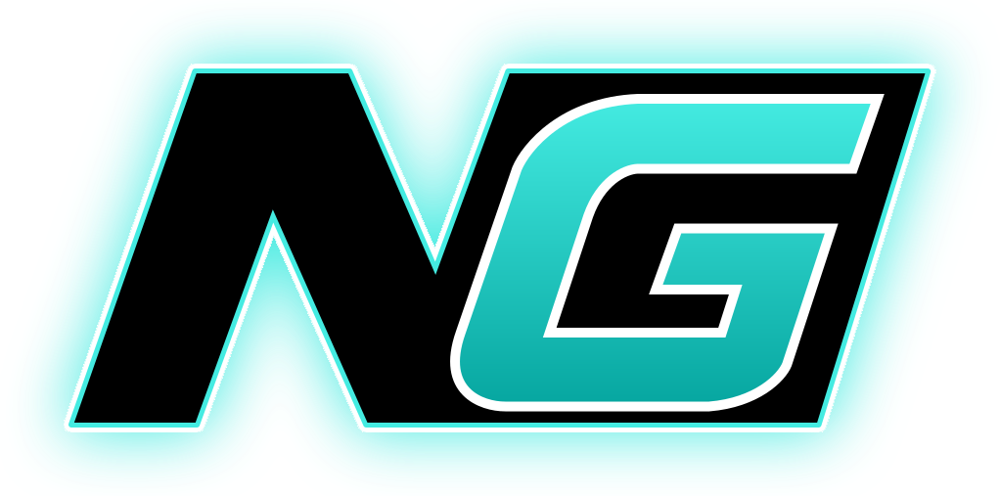
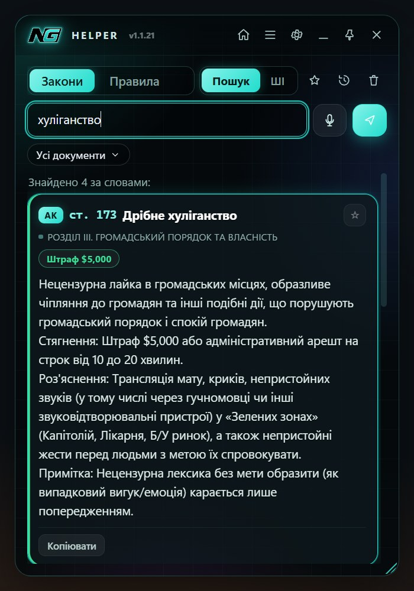
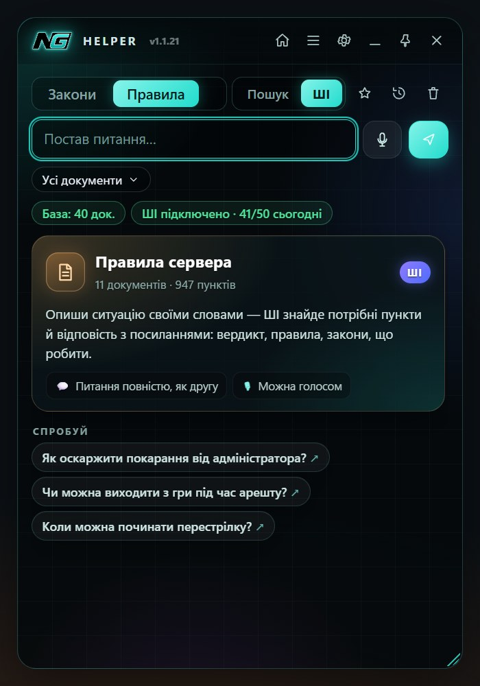
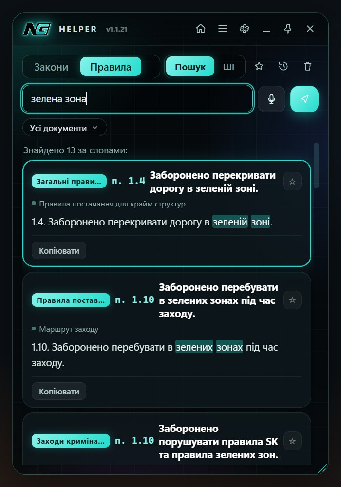
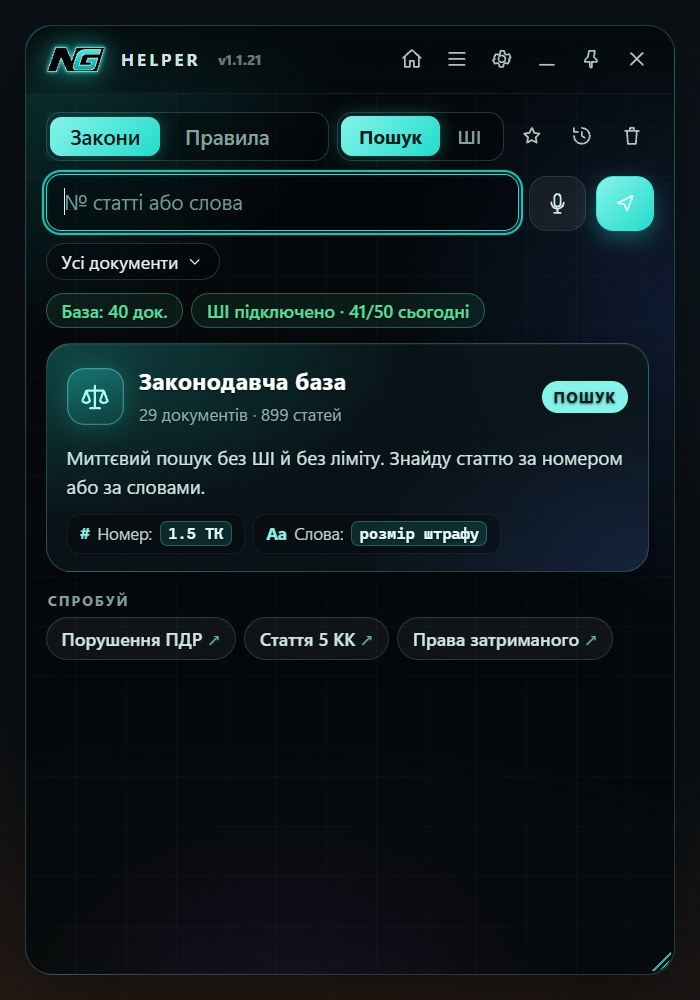
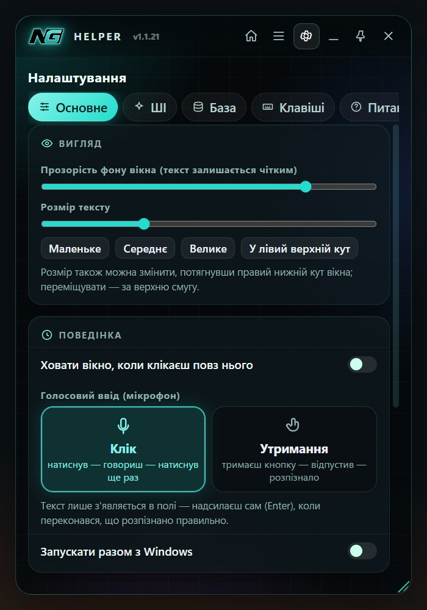

# NG Helper

**Помічник для гравців NG RP (GTA 5) — закони, правила й ШІ поверх гри**

Знайди статтю за секунду, спитай ШІ своїми словами, тримай вікно поверх GTA — і не виходь з гри.

**[🌐 Сайт проєкту](https://xomyakdru.github.io/NG-helper/)** · **[📦 Усі версії](https://github.com/XomyakDru/NG-helper/releases)**

> [!NOTE]
> **Неофіційний фанатський проєкт.** NG Helper зроблений гравцем для гравців і не має жодного стосунку до адміністрації, розробників чи команди NG RP (ng-gta5.com). Це не офіційний продукт NG, і сервер за нього не відповідає.

---

&nbsp;
&nbsp;

## ✨ Що вміє

| | |
|---|---|
| ⚖️ **Уся законодавча база** | Конституція, кодекси (КК, АК, ПК, ТК, Дорожній…) і закони штату NG — підтягуються з сайту автоматично |
| 📜 **Правила сервера** | Загальні правила, правила держ. організацій, крайму, лідерів, допитів, поставок… |
| ⚡ **Миттєвий пошук** | За номером (`1.5 ТК`) або словами — без ШІ, без ліміту, з підсвіткою |
| 🤖 **ШІ-юрист** | Питаєш своїми словами — отримуєш **вердикт, правила, закони й що робити** з посиланнями на статті |
| 🎙 **Голосом** | Натиснув — сказав — текст уже в полі |
| 🎮 **Поверх гри** | Вікно закріплюється поверх GTA, кліки проходять крізь нього — гра не втрачає фокус |
| 🔔 **Зміни в законах** | Helper сам перевіряє сайт і показує «було → стало» + сповіщення Windows |
| ⭐ **Шпаргалка** | Збережи потрібні статті й відкривай їх однією клавішею |
| ⌨️ **Гарячі клавіші** | Усе керування з клавіатури, кожну клавішу можна змінити |
| 🛡 **Режим стрімера** | OBS і Discord не бачать вікно — у записі тільки гра |
| 🔄 **Автооновлення** | Нові версії приходять самі |

## 🚀 Встановлення

1. **[Завантаж NG-Helper-Setup.exe](https://github.com/XomyakDru/NG-helper/releases/latest/download/NG-Helper-Setup.exe)** і запусти.
2. Готово — закони й правила завантажаться з ng-gta5.com самі, **входити в акаунт не потрібно**.

> **GTA має працювати в режимі «У вікні без рамки» (Borderless)** — інакше оверлей не буде видно поверх гри.
>
> Windows може показати «Невідомий видавець» — натисни **Детальніше → Виконати все одно**. Це звичайно для безкоштовних програм без платного підпису.

## ⌨️ Клавіші

| Дія | Клавіша |
|---|---|
| Показати / сховати Helper | <kbd>Ctrl</kbd>+<kbd>Alt</kbd>+<kbd>N</kbd> |
| Закріпити поверх гри / повернути керування | <kbd>Ctrl</kbd>+<kbd>Alt</kbd>+<kbd>P</kbd> |
| Закони ↔ Правила | <kbd>Tab</kbd> |
| Пошук ↔ ШІ | <kbd>Shift</kbd>+<kbd>Tab</kbd> |
| Сказати голосом | <kbd>Ctrl</kbd>+<kbd>Space</kbd> |
| Копіювати статтю з покаранням | <kbd>Ctrl</kbd>+<kbd>C</kbd> |
| Шпаргалка / Історія | <kbd>Ctrl</kbd>+<kbd>B</kbd> / <kbd>Ctrl</kbd>+<kbd>H</kbd> |

Усі клавіші змінюються в **Налаштування → Клавіші**.

## ❓ Питання

<b>Це чит? Мене не заблокують?</b>

Ні. Helper — окрема програма-довідник: вона не втручається в гру, не читає її пам'ять і нічого не змінює в GTA. Це як відкрити сайт з законами, тільки зручніше.

<b>Це безкоштовно?</b>

Так. Пошук — без обмежень. ШІ — безкоштовний денний ліміт запитів (видно в рядку статусу), щодня оновлюється.

<b>Треба входити в акаунт ng-gta5.com?</b>

Ні. Helper сам завантажує закони й правила з сайту — без входу, логіна й пароля.

<b>Не видно вікна поверх гри</b>

Перемкни GTA в режим «У вікні без рамки» (Borderless) у налаштуваннях графіки. Якщо гаряча клавіша не працює — її могла зайняти інша програма (Discord, NVIDIA, OBS): зміни її в Налаштування → Клавіші.

<b>Як оновити?</b>

Нічого робити не треба — Helper сам запропонує оновитися, коли вийде нова версія.

&nbsp;

NG Helper — неофіційний фанатський проєкт для гравців NG RP, не повʼязаний з адміністрацією й командою NG. GTA V — торгова марка Rockstar Games. Назви сервера й документів належать їхнім власникам.

